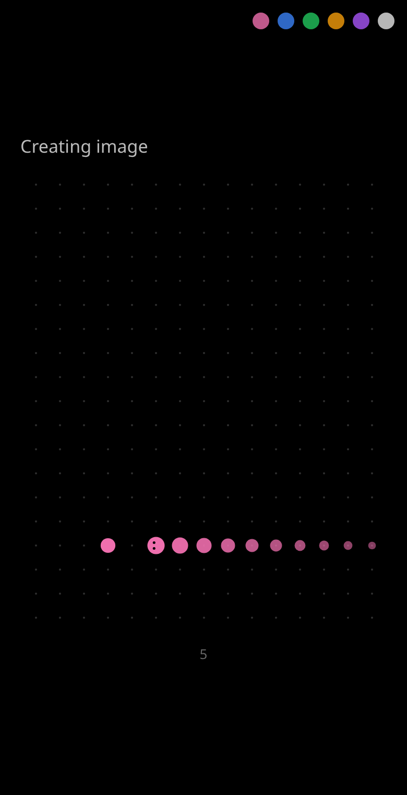

# 复刻ChatGPT生图时的贪吃蛇小游戏

ChatGPT 生成图片时，等待界面上那条点阵小蛇，用一个 HTML 文件复刻出来，可以真的玩。

## 怎么玩

下载 `index.html`，用浏览器直接打开就能玩，不需要安装任何依赖，也不需要联网。

| 操作 | 电脑 | 手机 |
| --- | --- | --- |
| 开始 / 重开 | 空格键或回车，或点击画面 | 点击画面 |
| 转向 | 方向键或 WASD | 在屏幕上滑动 |

蛇可以穿墙，只有撞到自己才会死，死了眼睛会变成 ×。

右上角的圆点可以换蛇的颜色，包括白底黑蛇主题。最高分和颜色都保存在浏览器的 localStorage 里。

## 特点

- 单文件，纯 HTML、CSS 和 JavaScript，没有外部依赖
- 还原 ChatGPT 生图时的 "Creating image" 点阵背景风格
- 游戏中食物会呼吸式缩放，开始前和死亡后保持静止
- 支持高分屏，电脑和手机都能玩

## 开源协议

[MIT License](LICENSE)
